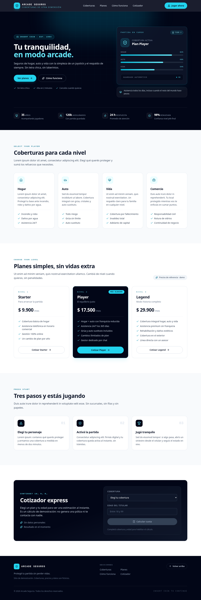

# arcade-seguros

Una landing page de seguros con un estilo retro arcade.

> App generada automáticamente por [MetaBuilder Orchestrator](https://github.com/damianra/metabuilder-orchestrator) usando [OpenCode](https://opencode.ai) como motor de agente (via ACP).



## Demo

Publicada en GitHub Pages: https://damianra.github.io/arcade-seguros/

## Stack

- React + Vite + Tailwind CSS (frontend)
- Vitest (tests) + Playwright + Chromium (E2E)

## Requisitos

- Node.js >= 20

## Levantar el proyecto

```bash
npm install
npm run dev        # frontend en http://localhost:5173
```

## Tests

```bash
npm test           # suite Vitest
npm run test:e2e   # E2E Playwright (Chromium)
```

## Deploy

El build de `dist/` queda publicado en GitHub Pages (`https://damianra.github.io/arcade-seguros/`) desde la rama `gh-pages`. Pages sirve solo el frontend; en apps fullstack el backend corre aparte (`npm run api`).
